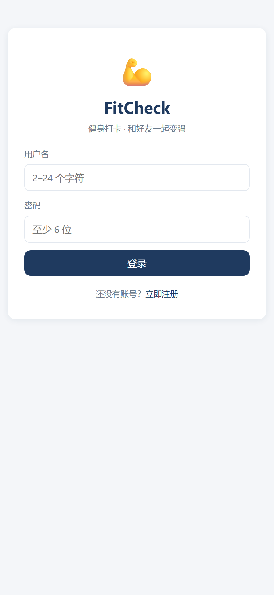
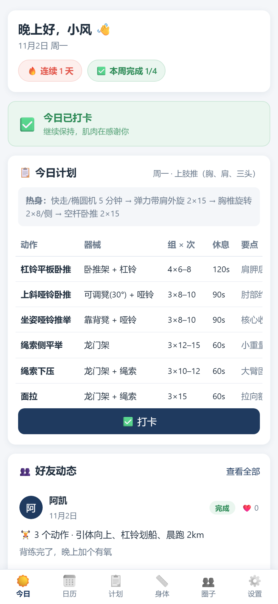
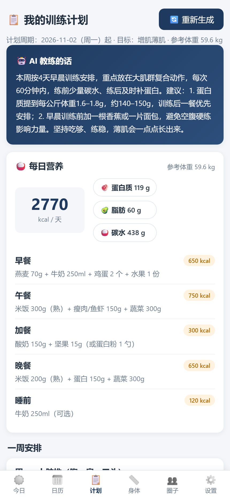
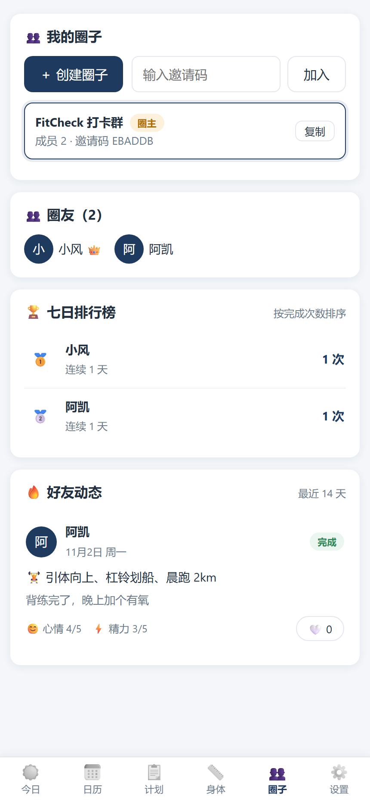
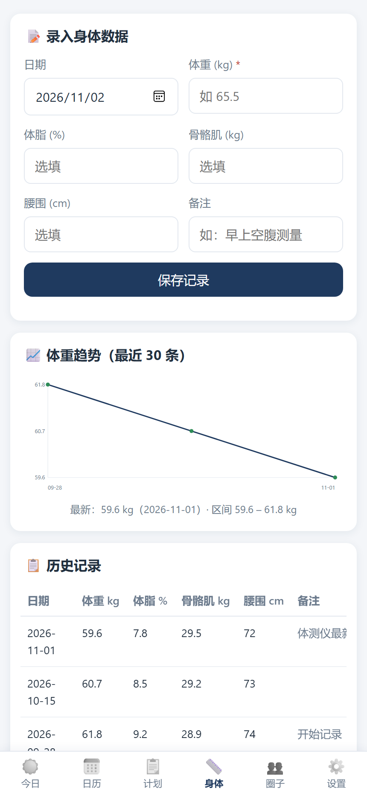
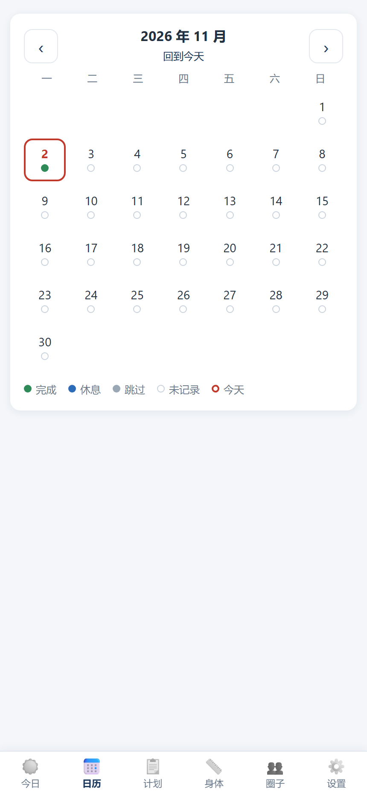

# FitCheck · 健身打卡小圈子


一个面向**小圈子**的健身打卡 Web 应用：录入身体数据 → 生成个性化健身/饮食计划（规则引擎 + DeepSeek AI 教练）→ 按计划模板每日打卡、写心得 → 圈子里互相看打卡、点赞、排行 → 每日督促提醒。

> 为个人/小团体自用而设计：数据本地化部署、无需注册第三方服务，手机浏览器「添加到主屏幕」即可像 App 一样使用。

## ✨ 功能特性

- **账号体系**：注册/登录（密码加盐哈希 + JWT），多用户彼此隔离
- **身体数据**：体重 / 体脂 / 骨骼肌 / 腰围录入，内联 SVG 体重趋势图
- **AI 计划生成**：Mifflin-St Jeor 公式算 BMR/TDEE → 按目标（增肌薄肌 / 减脂 / 塑形）生成热量与三大营养素 → 7 天训练动作表；DeepSeek 生成个性化教练点评
- **每日打卡**：按当天计划动作勾选（组数/次数/重量可回填），支持自定义项目、心得、心情/精力星级、公开或仅自己可见；月历视图四色状态
- **好友圈子**：邀请码创建/加入圈子，动态流、点赞、7 日完成榜（🥇🥈🥉）、连续打卡天数
- **督促提醒**：页面内横幅 + 浏览器通知（按设置时间），支持 PWA 添加到主屏幕
- **数据安全**：身体数据仅本人可见；每日自动备份；支持每位成员填写自己的 AI Key
- **可扩展**：纯 REST API，前端为静态资源，便于替换为小程序等其它客户端

## 📱 界面预览

<table>
<tr>
<td align="center"><br><sub>登录 / 注册</sub></td>
<td align="center"><br><sub>今日打卡</sub></td>
<td align="center"><br><sub>AI 训练计划</sub></td>
</tr>
<tr>
<td align="center"><br><sub>圈子动态与排行</sub></td>
<td align="center"><br><sub>身体数据</sub></td>
<td align="center"><br><sub>打卡日历</sub></td>
</tr>
</table>

## 🏗️ 技术架构

```
手机 / 电脑浏览器（响应式 + PWA）
        │  HTTPS / HTTP
        ▼
FastAPI (uvicorn) ──── SQLite（Docker 数据卷，每日自动备份）
        │
        └── DeepSeek API（生成个性化教练点评，可选用个人 Key）
```

- **后端**：Python 3.12 · FastAPI · SQLite · PyJWT，全部接口在 `server/app.py`
- **前端**：原生 HTML / CSS / JS（无框架、无构建步骤，离线可用），hash 路由 + 8 个页面模块
- **部署**：Docker Compose 一键部署，容器开机自启，SQLite 数据挂载独立卷
- **AI**：规则引擎负责所有数值计算（热量/蛋白质/碳水），DeepSeek 只负责文字点评与个性化表达

## 🚀 本地开发

```powershell
cd server
python -m venv .venv
.\.venv\Scripts\python -m pip install -i https://pypi.tuna.tsinghua.edu.cn/simple -r requirements.txt
.\.venv\Scripts\python -m uvicorn app:app --host 127.0.0.1 --port 8000
```

浏览器打开 <http://127.0.0.1:8000/>。若需 AI 点评，复制 `server/.env.example` 为 `server/.env` 并填入 `DEEPSEEK_API_KEY`。

## ☁️ 云服务器部署

详见 [deploy/README.md](deploy/README.md)。最快路径：

```bash
# 服务器（Ubuntu 22.04/24.04）上传项目后执行
bash deploy/setup.sh     # 自动装 Docker、写入 Key、构建启动、放行端口
```

另有 [pack.py](deploy/pack.py) 打包、[backup.sh](deploy/backup.sh) 每日备份、[Dockerfile](deploy/Dockerfile) 与 [docker-compose.yml](deploy/docker-compose.yml)。

## 📁 目录结构

```
fitcheck/
├── server/                # FastAPI 后端
│   ├── app.py             # 全部接口 + 计划生成 + 静态托管
│   ├── requirements.txt
│   └── .env.example       # DEEPSEEK_API_KEY 模板（.env 不入库）
├── web/                   # 前端静态页面
│   ├── index.html
│   ├── css/style.css
│   └── js/                # api.js / app.js / pages/*.js
├── docs/
│   ├── api.md             # 接口约定
│   ├── 使用手册.md        # 面向用户的说明
│   └── screenshots/       # 界面截图
├── deploy/                # 部署与运维脚本
├── LICENSE
└── README.md
```

## 🔌 API

完整接口见 [docs/api.md](docs/api.md)，主要分组：

| 分组 | 路径 |
|---|---|
| 认证 | `/api/auth/register`、`/api/auth/login`、`/api/auth/me` |
| 资料 | `/api/profile` |
| 身体数据 | `/api/body/records` |
| 计划 | `/api/plans/generate`、`/api/plans/current` |
| 打卡 | `/api/checkins` |
| 圈子 | `/api/circles`、`/api/feed`、排行榜、点赞 |
| 统计 | `/api/stats`、`/api/config/public`、`/api/health` |

## 🗺️ 路线图

- [x] 多用户账号、身体数据、AI 计划、打卡、圈子、提醒、PWA
- [ ] 域名 + HTTPS（浏览器通知完整体验）
- [ ] 微信小程序客户端（复用同一套 REST API）
- [ ] 每周 AI 周报、成就徽章、数据导出

## ⚠️ 说明

- AI 生成的训练/饮食建议基于通用公式与公开健身经验，**仅供参考，不构成医疗建议**；有健康问题请咨询医生。
- 身体数据默认仅本人可见；打卡可逐条设置为「仅自己」。

## 📄 License

[MIT](LICENSE)
